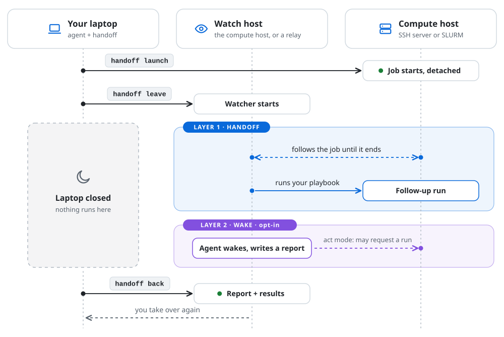
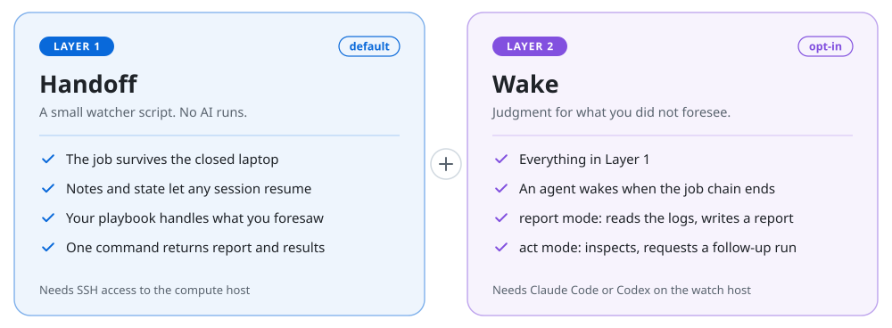

<div align="center">


<h3>Close the laptop. Your remote job keeps moving.</h3>

An agent skill for <b>Claude Code</b> and <b>Codex</b>.<br>
Say “I have to go” and a watcher follows your job on the lab server or cluster.<br>
Say “I’m back” and your agent picks up where it left off.

<p>


</p>

<b>English</b> · <a href="README.zh-CN.md">简体中文</a>

<a href="#why">Why</a> ·
<a href="#how-it-works">How it works</a> ·
<a href="#two-layers">Two layers</a> ·
<a href="#quick-start">Quick start</a> ·
<a href="#warnings">Warnings</a>

</div>

<br>

> **You** &nbsp; I have to go. Keep the fine-tuning going on `lab`.
>
> **Agent** &nbsp; Handed off. Layer 1 is active: when training finishes I start the evaluation, and if it runs out of memory I retry once with batch 128. Anything else waits for you. You can close the laptop.
>
> <sub>— eight hours later —</sub>
>
> **You** &nbsp; I'm back.
>
> **Agent** &nbsp; The first run ran out of memory after epoch 2. The retry with batch 128 finished, and the evaluation gave 91.2% accuracy. Results are in `./results`.

## Why

You drive a lab server or an HPC cluster from a laptop. The job runs over
there, the agent runs over here, and the laptop has to leave. Closing it loses
three things:

<table>
<tr>
<td width="33%" valign="top">
<h4>💥 The job</h4>
A job the agent started through its own connection dies with the session.
</td>
<td width="33%" valign="top">
<h4>🧠 The context</h4>
On return you explain again which job, where the log is, what counts as done, and what comes next.
</td>
<td width="33%" valign="top">
<h4>🌙 The night</h4>
The run finishes at 2 a.m. and the GPU idles until morning. Or it waits five hours in a queue, crashes in two minutes, and you find out the next day.
</td>
</tr>
</table>

Cloud agent sessions do not help here: they cannot reach a private server
behind a bastion or a campus cluster.

## How it works

<picture>
  <source media="(prefers-color-scheme: dark)" srcset="assets/flow-en-dark.svg">
  
</picture>

- **`handoff launch`** starts the job detached, so it survives the session.
- **`handoff leave`** stores the handoff notes and starts a watcher. The laptop can close.
- **`handoff back`** prints the report, collects the results, and stops a watcher that is still waiting, so your agent takes over again.

One bash script does all of it. It copies itself to the remote hosts; nothing is installed there by hand.

## Two layers

<picture>
  <source media="(prefers-color-scheme: dark)" srcset="assets/layers-en-dark.svg">
  
</picture>

| | Layer 1 · Handoff | Layer 2 · Wake |
|---|---|---|
| **Runs while you are away** | A watcher script. No AI. | The watcher, plus an agent that starts when the job chain ends and exits when it is done. |
| **Handles** | What you foresaw, through a playbook written before you leave. | What you did not foresee. `report` mode writes a report; `act` mode can also inspect the host and request a follow-up run. |
| **Needs** | SSH access to the compute host. | Claude Code or Codex, installed and logged in on the watch host, in a region the provider serves. |
| **Risk** | A wrong playbook rule wastes compute. | An unattended agent with shell access. Read the [warnings](#warnings). |

Layer 1 is on by default. Layer 2 is off until you turn it on.

### Playbooks: decide now, run later

A playbook is a short bash script your agent writes before you leave and shows
you for approval. The watcher runs it each time a run ends.

```bash
# out of memory on the first run: retry once with half the batch size
if [ "$HANDOFF_ATTEMPT" = 1 ] && grep -q 'CUDA out of memory' "$HANDOFF_LOG"; then
  echo 'python train.py --batch-size 128' > "$HANDOFF_NEXT"
fi
```

A handoff runs at most `MAX_ATTEMPTS` times (default 3), so a rule cannot loop
forever. More in the [playbook reference](skills/job-handoff/references/playbook.md).

### Where the watcher runs

| Your situation | Watch host |
|---|---|
| Ordinary server or cluster | The compute host itself. Nothing else to set up. |
| The login node forbids long-running processes | A relay: any small always-on Linux machine. For Layer 1 it can be anywhere. |
| You want Layer 2, and the compute host cannot run the agent | A relay in a region the agent's provider serves. |

## Quick start

**1. Install**

```bash
git clone https://github.com/Catchxu/job-handoff.git
```

```bash
./job-handoff/install.sh
```

This links the skill into `~/.claude/skills` (Claude Code) and
`~/.agents/skills` (Codex), and the `handoff` command into `~/.local/bin`.
You need `bash`, `ssh` and `rsync` locally; `bash`, `nohup` and `setsid` on
the remote hosts, which Linux has by default.

**2. Talk to your agent**

| You say | The agent does |
|---|---|
| “Set up job-handoff for my server `lab`” | Asks about hosts, relay, notification and Layer 2, writes the configuration, runs `handoff doctor`. |
| “Start the training on `lab`” | Starts it with `handoff launch`, so it survives the session. |
| “I have to go” | Writes the handoff notes, proposes a playbook for your approval, runs `handoff leave`, and tells you what will and will not happen while you are away. |
| “I’m back” | Runs `handoff back`, reads the report, collects the results, and continues the work. |

<details>
<summary><b>Prefer the command line?</b></summary>

<br>

```bash
handoff init                    # write ~/.job-handoff/config
handoff host add lab            # detects SLURM by itself
handoff doctor                  # every line must say ok

handoff launch --host lab --name bert-ft --dir ~/proj --cmd 'python train.py'
handoff notes <id>              # prints the notes file to fill in
handoff leave <id> --playbook playbook.sh --fetch out/metrics.json --into ./results
handoff back
```

On a SLURM cluster the arguments go to `sbatch`:

```bash
handoff launch --host hpc --name bert-ft --dir ~/proj -- train.sbatch
```

All settings: [configuration reference](skills/job-handoff/references/configuration.md).

</details>

## Warnings

> [!WARNING]
> **Layer 1**
> - A playbook runs commands on the compute host with nobody watching. A wrong
>   rule burns GPU hours or allocation. The attempt cap (`MAX_ATTEMPTS`,
>   default 3) is the only brake.
> - The watcher is a long-running process. Some clusters forbid those on login
>   nodes. Check your site's policy or use a relay.
> - A relay holds an SSH key that reaches your compute host. Create a dedicated
>   key on the relay, never copy your personal private key there, and follow
>   the access rules of your lab or cluster. Whoever controls the relay
>   controls that account.
> - Results prefetched to a relay are stored on it. Do not prefetch data that
>   must not leave the compute site.
> - Messages sent to public notification services can be read by anyone who
>   knows the topic.
> - Nothing thinks in Layer 1. A failure the playbook did not foresee waits
>   until you return.

> [!CAUTION]
> **Layer 2**
> - In `act` mode an AI agent runs shell commands on your compute host with
>   nobody watching. It can do anything your SSH account can do, including
>   deleting data and using up your allocation. Start with `report` mode.
> - The agent reads job logs. Text in a log can steer an agent (prompt
>   injection). Do not use `act` mode on jobs that process untrusted input.
> - The agent's login token is stored on the watch host. Anyone with access to
>   that host can use your Claude or Codex account.
> - Each wake uses your subscription or API credit without you seeing it.
> - The agent sees only the handoff notes, the log tails and the playbook
>   output, not your conversation.
> - Running an AI agent on a shared cluster login node may violate site policy.

## How it compares

| | `nohup` / `tmux` | Cloud agent session | Agent living on a server | **job-handoff** |
|---|:---:|:---:|:---:|:---:|
| Reaches a private server or cluster | ✅ | ❌ | ✅ | ✅ |
| The job survives the closed laptop | ✅ | ➖ | ✅ | ✅ |
| The agent resumes with full context | ❌ | ➖ | ✅ | ✅ |
| Something happens when the job ends | ❌ | ➖ | ✅ | ✅ |
| No always-on agent with shell access | ✅ | ✅ | ❌ | ✅ |

➖ does not apply: a cloud session cannot reach the job in the first place.
With job-handoff, no agent runs while you are away in Layer 1, and in Layer 2
one runs for about a minute when the job chain ends.

## Status

Version 0.1.0.

| Part | Tested |
|---|---|
| Plain SSH host: launch, leave, playbook follow-ups, return, fetch | ✅ Real servers, one behind a bastion |
| SLURM: launch, playbook follow-up, cancel, adopt, return, fetch | ✅ Real cluster (SLURM 25.11) |
| Relay, with the compute host behind a bastion | ✅ Real servers |
| Layer 2 `report` mode | ✅ Real Claude Code and real Codex |
| Layer 2 `act` mode | 🧪 Simulation only |
| macOS as the local machine | ⬜ Not tested |

## Limits

- Jobs on your own machine stop with it; no handoff is possible.
- A job that was not started detached cannot be rescued. Start jobs with `handoff launch`.
- SLURM job arrays and other schedulers (PBS, LSF) are not supported.
- One job chain per handoff. Several jobs need several handoffs.

## License

[MIT](LICENSE)
