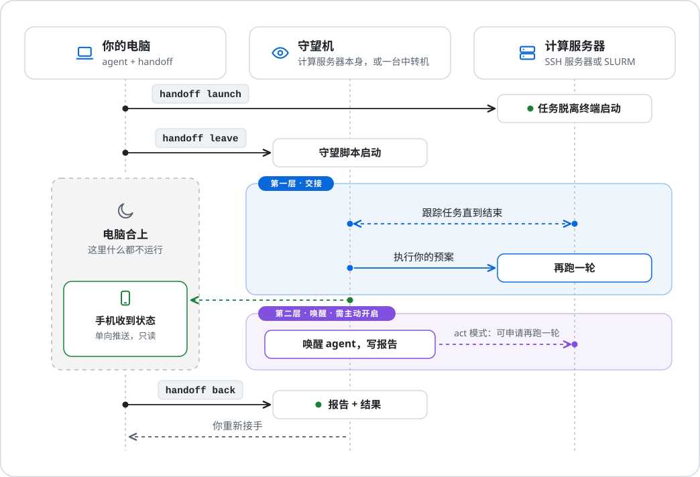
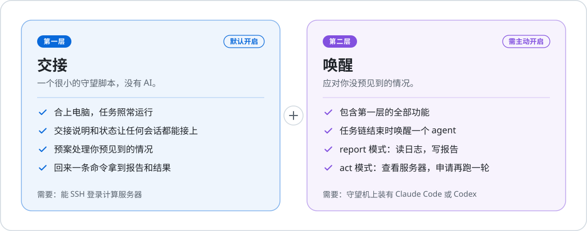

<div align="center">


<h3>合上电脑，远程任务照常推进。</h3>

一个给 <b>Claude Code</b> 和 <b>Codex</b> 用的 agent skill。<br>
说一句“我要走了”，守望脚本就在实验室服务器或集群上替你跟着任务。<br>
说一句“我回来了”，agent 从断开的地方接着干。

<p>


</p>

<a href="README.md">English</a> · <b>简体中文</b>

<a href="#为什么需要它">为什么需要它</a> ·
<a href="#工作方式">工作方式</a> ·
<a href="#两层实现">两层实现</a> ·
<a href="#快速上手">快速上手</a> ·
<a href="#警告">警告</a>

</div>

<br>

> **你** &nbsp; 我要走了，`lab` 上的微调帮我盯着。
>
> **Agent** &nbsp; 已交接，当前是第一层：训练跑完我会接着跑评估；如果显存不够，我用 batch 128 重跑一次。其他情况等你回来处理。可以合上电脑了。
>
> <sub>— 八小时后 —</sub>
>
> **你** &nbsp; 我回来了。
>
> **Agent** &nbsp; 第一次训练在第 2 轮之后显存溢出，改用 batch 128 重跑成功，评估准确率 91.2%。结果已经放在 `./results`。

## 为什么需要它

你用笔记本指挥实验室服务器或 HPC 集群：任务在那边跑，agent 在这边跑，而笔记本要被带走。
合上电脑会丢掉三样东西：

<table>
<tr>
<td width="33%" valign="top">
<h4>💥 任务</h4>
agent 通过自己的连接启动的任务，会跟着会话一起断掉。
</td>
<td width="33%" valign="top">
<h4>🧠 上下文</h4>
回来后要重新交代：哪个任务、日志在哪、怎么算完成、下一步做什么。
</td>
<td width="33%" valign="top">
<h4>🌙 一整夜</h4>
凌晨 2 点跑完，GPU 空到早上。或者排队 5 小时，启动 2 分钟就崩了，第二天才发现。
</td>
</tr>
</table>

云端的 agent 会话解决不了这个问题：它连不上堡垒机后面的私有服务器，也连不上校园集群。

## 工作方式



- **`handoff launch`**：脱离终端启动任务，任务不会随会话断掉。
- **`handoff leave`**：保存交接说明，启动守望脚本。之后可以合上电脑。
- **`handoff back`**：给出报告，收回结果；守望脚本如果还在等待就停掉它，由 agent 重新接手。

全部功能由一个 bash 脚本完成。它会把自己复制到远程机器，服务器上不需要手动安装任何东西。

## 两层实现



| | 第一层 · 交接 | 第二层 · 唤醒 |
|---|---|---|
| **你离开期间运行的东西** | 一个守望脚本，没有 AI。 | 守望脚本，再加一个 agent：任务链结束时启动，处理完就退出。 |
| **处理什么** | 你预见到的情况，靠离开前写好的预案。 | 你没预见到的情况。`report` 模式写一份报告；`act` 模式还能查看服务器，并申请再跑一轮。 |
| **需要什么** | 能 SSH 登录计算服务器。 | 守望机上装有并登录了 Claude Code 或 Codex，且位于服务商支持的地区。 |
| **风险** | 预案写错会浪费算力。 | 一个无人值守、能执行命令的 agent。请先读[警告](#警告)。 |

第一层默认开启。第二层在你主动开启之前一直是关闭的。

### 预案：现在做决定，之后再执行

预案（playbook）是一段很短的 bash 脚本，由 agent 在你离开前写好并交给你确认。
每一轮任务结束时，守望脚本都会执行它。

```bash
# 第一轮显存不够：把 batch 减半，重跑一次
if [ "$HANDOFF_ATTEMPT" = 1 ] && grep -q 'CUDA out of memory' "$HANDOFF_LOG"; then
  echo 'python train.py --batch-size 128' > "$HANDOFF_NEXT"
fi
```

一次交接最多运行 `MAX_ATTEMPTS` 轮（默认 3），规则不会无限循环。
更多写法见[预案说明](skills/job-handoff/references/playbook.md)（英文）。

### 手机上看状态

电脑合上期间，守望脚本可以把状态推送到你的手机。推送是单向的：你只能查看，手机上发不出任何指令到服务器。

| 什么时候 | 消息 |
|---|---|
| 排队的作业开始运行 | `bert-ft: attempt 1 is running on hpc` |
| 一轮结束，预案启动了下一轮 | `bert-ft: attempt 1 FAILED, the playbook started attempt 2`，附日志最后几行 |
| 连续 30 分钟连不上计算服务器，以及恢复连接时 | `bert-ft: cannot reach lab` |
| 交接结束 | `bert-ft on lab: COMPLETED after 2 attempt(s)`，附每一轮的结果，以及 agent 报告的开头或日志最后几行 |

配置方法：手机装 [ntfy](https://ntfy.sh)，订阅一个足够长的随机主题名，再在 `~/.job-handoff/config` 里加一行：

```bash
NOTIFY_CMD='curl -fsS -o /dev/null -H "Title: $1" -d "$2" https://ntfy.sh/jh-your-long-random-topic'
```

也可以直接让 agent 帮你配置手机通知。Bark 和飞书也能用，
见[配置说明](skills/job-handoff/references/configuration.md#phone-notifications)（英文）。

### 守望脚本跑在哪里

| 你的情况 | 守望机 |
|---|---|
| 普通服务器或集群 | 计算服务器本身，不需要额外准备。 |
| 登录节点不允许长期运行的进程 | 一台中转机：任意一台常开的小型 Linux 机器。只用第一层时，它放在哪里都可以。 |
| 想用第二层，但计算服务器上跑不了 agent | 一台位于 agent 服务商支持地区的中转机。 |

## 快速上手

**1. 安装**

```bash
git clone https://github.com/Catchxu/job-handoff.git
```

```bash
./job-handoff/install.sh
```

安装脚本会把 skill 链接到 `~/.claude/skills`（Claude Code）和 `~/.agents/skills`（Codex），
并把 `handoff` 命令链接到 `~/.local/bin`。
本机需要 `bash`、`ssh`、`rsync`；远程机器需要 `bash`、`nohup`、`setsid`，Linux 都自带。

**2. 直接和 agent 说话**

| 你说 | agent 做的事 |
|---|---|
| “帮我给服务器 `lab` 配置 job-handoff” | 询问服务器、中转机、通知方式和是否开第二层，写好配置，运行 `handoff doctor` 检查。 |
| “帮我配置手机通知” | 生成一个私密的 ntfy 主题名给你订阅，写好命令，发一条测试消息。 |
| “在 `lab` 上开始训练” | 用 `handoff launch` 启动，任务不会随会话断掉。 |
| “我要走了” | 写交接说明，拟一份预案给你确认，运行 `handoff leave`，并告诉你离开期间会发生什么、不会发生什么。 |
| “我回来了” | 运行 `handoff back`，读报告，收回结果，接着干活。 |

<details>
<summary><b>想直接用命令行？</b></summary>

<br>

```bash
handoff init                    # 生成 ~/.job-handoff/config
handoff host add lab            # 自动识别 SLURM
handoff doctor                  # 每一行都应该是 ok

handoff launch --host lab --name bert-ft --dir ~/proj --cmd 'python train.py'
handoff notes <id>              # 打印交接说明文件的路径，把说明写进去
handoff leave <id> --playbook playbook.sh --fetch out/metrics.json --into ./results
handoff back
```

在 SLURM 集群上，参数会原样交给 `sbatch`：

```bash
handoff launch --host hpc --name bert-ft --dir ~/proj -- train.sbatch
```

全部设置见[配置说明](skills/job-handoff/references/configuration.md)（英文）。

</details>

## 警告

> [!WARNING]
> **第一层**
> - 预案会在没人看着的情况下，在计算服务器上执行命令。规则写错会白白消耗 GPU 时间或机时配额。
>   唯一的刹车是尝试次数上限（`MAX_ATTEMPTS`，默认 3）。
> - 守望脚本是一个长期运行的进程。有些集群禁止在登录节点上运行这类进程，
>   请先查看所在集群的规定，或者使用中转机。
> - 中转机上存着一把能登录你计算服务器的 SSH 密钥。请在中转机上新生成一把专用密钥，
>   绝不要把个人私钥复制过去，并遵守实验室或集群的访问规定。谁控制了中转机，谁就控制了那个账号。
> - 提前取回的结果会存放在中转机上。不允许离开计算站点的数据，不要设置提前取回。
> - 通知里有任务名、日志片段和 agent 报告的开头。在 ntfy.sh 这类公共服务上，任何知道主题名的人都能看到，请用足够长的随机主题名。
> - 第一层没有任何判断力。预案没预见到的失败，只能等你回来处理。

> [!CAUTION]
> **第二层**
> - `act` 模式下，AI agent 会在没人看着的情况下，在你的计算服务器上执行命令。
>   你的 SSH 账号能做的事它都能做，包括删除数据、用光机时配额。请先从 `report` 模式用起。
> - agent 会读任务日志。日志里的文字可能左右 agent 的行为（提示注入）。
>   处理不可信输入的任务，不要用 `act` 模式。
> - agent 的登录令牌存放在守望机上。能访问那台机器的人，就能使用你的 Claude 或 Codex 账号。
> - 每次唤醒都会在你看不到的时候消耗订阅额度或 API 费用。
> - agent 只看得到交接说明、各轮日志的末尾和预案输出，看不到你们的对话。
> - 在共享集群的登录节点上运行 AI agent，可能违反集群规定。

## 和其他做法的对比

| | `nohup` / `tmux` | 云端 agent 会话 | 让 agent 常驻服务器 | **job-handoff** |
|---|:---:|:---:|:---:|:---:|
| 连得上私有服务器或集群 | ✅ | ❌ | ✅ | ✅ |
| 合上电脑，任务不断 | ✅ | ➖ | ✅ | ✅ |
| agent 带着完整上下文接上 | ❌ | ➖ | ✅ | ✅ |
| 任务结束时有后续动作 | ❌ | ➖ | ✅ | ✅ |
| 没有常驻的、能执行命令的 agent | ✅ | ✅ | ❌ | ✅ |

➖ 表示不适用：云端会话根本连不上那个任务。
使用 job-handoff 时，第一层在你离开期间没有 agent 在运行；第二层只在任务链结束时运行一分钟左右。

## 当前状态

版本 0.1.0。

| 部分 | 测试情况 |
|---|---|
| 普通 SSH 服务器：启动、交接、预案续跑、返回、取回结果 | ✅ 真实服务器，其中一台在堡垒机后面 |
| SLURM：启动、预案续跑、取消、接管已有作业、返回、取回结果 | ✅ 真实集群（SLURM 25.11） |
| 中转机，计算服务器在堡垒机后面 | ✅ 真实服务器 |
| 第二层 `report` 模式 | ✅ 真实的 Claude Code 和 Codex |
| 手机通知（ntfy）：续跑、最终结果和 agent 摘要 | ✅ 真实手机 |
| 第二层 `act` 模式 | 🧪 只在模拟环境中测试 |
| 本机为 macOS | ⬜ 未测试 |

## 限制

- 跑在你自己电脑上的任务会随电脑一起停，无法交接。
- 没有脱离终端启动的任务救不回来。请用 `handoff launch` 启动任务。
- 不支持 SLURM 的 job array，也不支持其他调度器（PBS、LSF）。
- 一次交接只跟一条任务链。多个任务需要多次交接。

## 许可证

[MIT](LICENSE)
